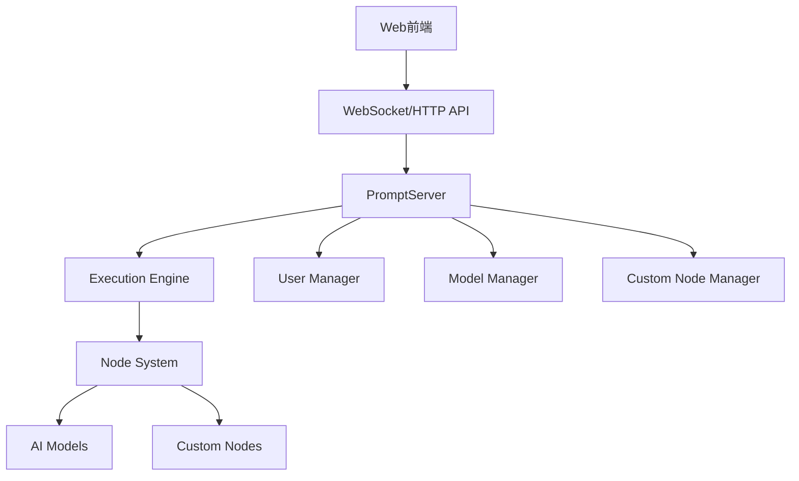

# ComfyUI 开发指南

## 目录
- [项目概述](#项目概述)
- [环境搭建](#环境搭建)
- [项目架构](#项目架构)
- [核心组件](#核心组件)
- [自定义节点开发](#自定义节点开发)
- [API开发](#api开发)
- [前端开发](#前端开发)
- [模型管理](#模型管理)
- [调试与测试](#调试与测试)
- [部署与发布](#部署与发布)
- [贡献指南](#贡献指南)

## 项目概述

ComfyUI 是一个基于节点/图形界面的强大AI图像生成引擎，支持多种Stable Diffusion模型和高级工作流。它采用模块化设计，允许开发者通过自定义节点扩展功能。

### 主要特性
- 🎨 节点式图形界面，无需编程即可创建复杂工作流
- 🚀 支持多种AI模型：SD1.x、SD2.x、SDXL、Stable Cascade、SD3等
- 🔧 高度可扩展的插件系统
- 💻 跨平台支持：Windows、Linux、macOS
- 🎯 智能内存管理，支持低显存设备
- 🌐 完整的REST API和WebSocket支持

## 环境搭建

### 系统要求
- Python 3.10+ (推荐3.12+)
- 支持CUDA的NVIDIA GPU (推荐) 或 AMD/Intel GPU
- 8GB+ RAM (推荐16GB+)
- 足够的存储空间用于模型文件

### 安装步骤

1. **克隆项目**
```bash
git clone https://github.com/comfyanonymous/ComfyUI.git
cd ComfyUI
```

2. **安装Python依赖**
```bash
# 对于NVIDIA GPU
pip install torch torchvision torchaudio --extra-index-url https://download.pytorch.org/whl/cu130

# 安装其他依赖
pip install -r requirements.txt
```

3. **准备模型文件**
将AI模型文件放入相应目录：
- `models/checkpoints/` - 主要模型文件
- `models/vae/` - VAE模型
- `models/loras/` - LoRA模型
- `models/controlnet/` - ControlNet模型

4. **启动服务**
```bash
python main.py --listen 0.0.0.0 --port 8188
```

## 项目架构

```
ComfyUI/
├── comfy/                    # 核心AI模型处理模块
│   ├── model_management.py   # 模型管理
│   ├── samplers.py          # 采样器
│   ├── lora.py              # LoRA处理
│   └── ...
├── comfy_api/               # API接口定义
├── comfy_api_nodes/         # API节点实现
├── custom_nodes/            # 自定义节点目录
├── nodes.py                 # 节点注册和管理
├── server.py                # Web服务器
├── execution.py             # 执行引擎
├── main.py                  # 主入口文件
└── web/                     # 前端资源
```

### 核心架构图



## 核心组件

### 1. 执行引擎 (execution.py)
负责工作流的执行和调度：
- `PromptExecutor` - 执行器主类
- `PromptQueue` - 任务队列管理
- `CacheType` - 缓存策略

### 2. 节点系统 (nodes.py)
管理所有节点的注册和加载：
- 内置节点注册
- 自定义节点加载
- 节点依赖管理

### 3. 模型管理 (comfy/model_management.py)
处理AI模型的加载和内存管理：
- 模型缓存
- 内存优化
- GPU/CPU切换

### 4. Web服务器 (server.py)
提供HTTP和WebSocket接口：
- REST API端点
- WebSocket实时通信
- 文件上传下载

## 自定义节点开发

### 基本结构

创建一个自定义节点需要以下步骤：

1. **创建节点类**
```python
from comfy_api.latest import ComfyExtension, io

class MyCustomNode(io.ComfyNode):
    @classmethod
    def define_schema(cls) -> io.Schema:
        return io.Schema(
            node_id="MyCustomNode",
            display_name="我的自定义节点",
            category="Custom",
            inputs=[
                io.Image.Input("image"),
                io.String.Input("text", default="Hello"),
            ],
            outputs=[
                io.Image.Output(),
            ],
        )
    
    @classmethod
    def execute(cls, image, text) -> io.NodeOutput:
        # 处理逻辑
        processed_image = process_image(image, text)
        return io.NodeOutput(processed_image)
```

2. **创建扩展类**
```python
class MyExtension(ComfyExtension):
    @override
    async def get_node_list(self) -> list[type[io.ComfyNode]]:
        return [MyCustomNode]

async def comfy_entrypoint() -> MyExtension:
    return MyExtension()
```

3. **添加API路由（可选）**
```python
from aiohttp import web
from server import PromptServer

@PromptServer.instance.routes.get("/my-api")
async def my_api_handler(request):
    return web.json_response({"status": "success"})
```

### 输入输出类型

支持的数据类型：
- `io.Image` - 图像数据
- `io.Latent` - 潜在空间数据
- `io.Model` - AI模型
- `io.VAE` - VAE模型
- `io.Conditioning` - 条件数据
- `io.String` - 字符串
- `io.Int` - 整数
- `io.Float` - 浮点数
- `io.Combo` - 下拉选择

### 高级特性

1. **懒加载输入**
```python
@classmethod
def check_lazy_status(cls, image, text):
    if some_condition:
        return ["text"]  # 需要评估text输入
    return []
```

2. **输入指纹**
```python
@classmethod
def fingerprint_inputs(cls, image, text):
    return f"{hash(image)}_{hash(text)}"
```

3. **前端扩展**
```python
# 设置前端资源目录
WEB_DIRECTORY = "./web"
```

## API开发

### REST API端点

ComfyUI提供丰富的REST API：

#### 工作流相关
- `POST /prompt` - 提交工作流
- `GET /history` - 获取执行历史
- `POST /history` - 管理历史记录

#### 文件管理
- `POST /upload/image` - 上传图像
- `GET /view` - 查看文件
- `POST /free` - 释放资源

#### 系统信息
- `GET /system_stats` - 系统状态
- `GET /object_info` - 节点信息

### WebSocket API

实时通信接口：
```javascript
const ws = new WebSocket('ws://localhost:8188/ws');

ws.onmessage = (event) => {
    const data = JSON.parse(event.data);
    switch(data.type) {
        case 'executing':
            console.log('正在执行节点:', data.data.node);
            break;
        case 'progress':
            console.log('进度:', data.data.value, '/', data.data.max);
            break;
        case 'executed':
            console.log('节点执行完成:', data.data.node);
            break;
    }
};
```

### 自定义API路由

在自定义节点中添加API：
```python
from aiohttp import web
from server import PromptServer

@PromptServer.instance.routes.post("/api/my-endpoint")
async def my_endpoint(request):
    data = await request.json()
    # 处理请求
    return web.json_response({"result": "success"})
```

## 前端开发

### 前端架构

ComfyUI使用Vue.js构建前端，支持：
- 节点编辑器
- 实时预览
- 工作流管理
- 设置界面

### 自定义前端扩展

1. **创建前端资源目录**
```python
WEB_DIRECTORY = "./web"
```

2. **添加JavaScript文件**
```javascript
// web/my_extension.js
import { app } from "/scripts/app.js";

// 注册自定义功能
app.registerExtension({
    name: "MyExtension",
    async setup() {
        // 初始化代码
    }
});
```

3. **样式定制**
```css
/* web/my_extension.css */
.my-custom-class {
    background-color: #f0f0f0;
}
```

## 模型管理

### 模型目录结构

```
models/
├── checkpoints/          # 主要模型文件
├── vae/                 # VAE模型
├── loras/               # LoRA模型
├── controlnet/          # ControlNet模型
├── embeddings/          # 文本嵌入
├── upscale_models/      # 超分辨率模型
└── ...
```

### 模型加载

```python
import comfy.model_management as model_management

# 加载模型
model = model_management.load_model(model_path)

# 卸载模型
model_management.unload_model(model)
```

### 内存管理

ComfyUI提供多种内存管理策略：
- `--highvram` - 高显存模式
- `--normalvram` - 标准显存模式
- `--lowvram` - 低显存模式
- `--cpu` - CPU模式

## 调试与测试

### 日志系统

```python
import logging

# 设置日志级别
logging.basicConfig(level=logging.DEBUG)

# 在节点中使用日志
logging.info("节点执行开始")
logging.error("发生错误: %s", error_message)
```

### 调试模式

启动调试模式：
```bash
python main.py --verbose DEBUG
```

### 单元测试

创建测试文件：
```python
import unittest
from my_custom_node import MyCustomNode

class TestMyCustomNode(unittest.TestCase):
    def test_execute(self):
        # 测试节点执行
        result = MyCustomNode.execute(test_image, "test")
        self.assertIsNotNone(result)
```

## 部署与发布

### 打包发布

1. **创建pyproject.toml**
```toml
[project]
name = "my-comfyui-extension"
version = "1.0.0"
description = "我的ComfyUI扩展"
dependencies = [
    "comfyui-frontend-package>=1.28.0"
]

[tool.comfy]
publisher_id = "my-publisher"
```

2. **构建包**
```bash
python -m build
```

### Docker部署

```dockerfile
FROM python:3.10-slim

WORKDIR /app
COPY . .

RUN pip install -r requirements.txt

EXPOSE 8188
CMD ["python", "main.py", "--listen", "0.0.0.0"]
```

## 贡献指南

### 开发流程

1. **Fork项目**
2. **创建功能分支**
3. **编写代码和测试**
4. **提交Pull Request**

### 代码规范

- 遵循PEP 8编码规范
- 添加适当的注释和文档
- 编写单元测试
- 更新相关文档

### 提交规范

```
feat: 添加新功能
fix: 修复bug
docs: 更新文档
style: 代码格式调整
refactor: 代码重构
test: 添加测试
chore: 构建过程或辅助工具的变动
```

## 常见问题

### Q: 如何解决CUDA内存不足？
A: 使用`--lowvram`或`--cpu`参数，或调整`--reserve-vram`参数。

### Q: 自定义节点不显示怎么办？
A: 检查节点类是否正确继承`io.ComfyNode`，并确保`comfy_entrypoint`函数正确返回扩展实例。

### Q: 如何调试WebSocket连接？
A: 在浏览器开发者工具中查看Network标签页的WebSocket连接状态。

### Q: 模型加载失败怎么处理？
A: 检查模型文件路径和格式，确保模型文件完整且格式正确。

## 资源链接

- [官方文档](https://docs.comfy.org/)
- [GitHub仓库](https://github.com/comfyanonymous/ComfyUI)
- [Discord社区](https://comfy.org/discord)
- [示例工作流](https://comfyanonymous.github.io/ComfyUI_examples/)

## 更新日志

- **v0.3.65** - 当前版本
  - 新增SD3支持
  - 改进内存管理
  - 优化节点执行性能

---

*本文档持续更新中，如有问题请提交Issue或联系维护团队。*
