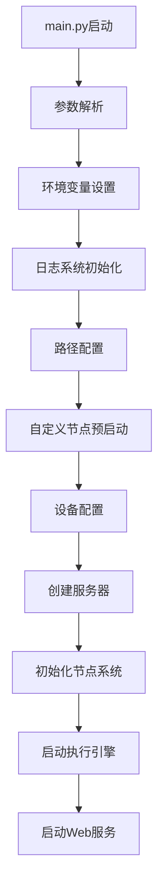
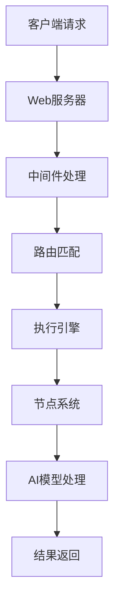

# ComfyUI 第一阶段：基础架构代码研究

## 📋 学习目标
- 深入理解ComfyUI的启动流程和初始化过程
- 掌握核心组件的架构设计和交互关系
- 理解Web服务器的实现机制
- 掌握执行引擎的工作原理
- 了解节点系统的管理机制

## 🎯 核心文件分析

### 1. main.py - 程序入口点

#### 1.1 文件概览
- **行数**: 371行
- **大小**: 14.7KB
- **作用**: ComfyUI的主入口点，负责程序启动和初始化

#### 1.2 关键代码分析

##### 导入和初始化
```python
import comfy.options
comfy.options.enable_args_parsing()  # 启用参数解析

import os
import importlib.util
import folder_paths
import time
from comfy.cli_args import args  # 命令行参数
from app.logger import setup_logger  # 日志系统
```

**分析要点**:
- `comfy.options.enable_args_parsing()` 必须在其他导入之前调用
- 使用模块化的导入结构，便于维护和测试

##### 环境变量设置
```python
if __name__ == "__main__":
    # 禁用遥测和跟踪
    os.environ['HF_HUB_DISABLE_TELEMETRY'] = '1'
    os.environ['DO_NOT_TRACK'] = '1'
    
    # 设置日志系统
    setup_logger(log_level=args.verbose, use_stdout=args.log_stdout)
```

**设计原理**:
- 在程序启动时立即设置环境变量，确保所有子模块都遵循这些设置
- 日志系统在早期初始化，便于后续调试

##### 路径配置函数
```python
def apply_custom_paths():
    # 处理额外模型路径配置
    extra_model_paths_config_path = os.path.join(os.path.dirname(os.path.realpath(__file__)), "extra_model_paths.yaml")
    if os.path.isfile(extra_model_paths_config_path):
        utils.extra_config.load_extra_path_config(extra_model_paths_config_path)
    
    # 设置输出目录
    if args.output_directory:
        output_dir = os.path.abspath(args.output_directory)
        logging.info(f"Setting output directory to: {output_dir}")
        folder_paths.set_output_directory(output_dir)
    
    # 设置默认模型文件夹
    folder_paths.add_model_folder_path("checkpoints", os.path.join(folder_paths.get_output_directory(), "checkpoints"))
    folder_paths.add_model_folder_path("clip", os.path.join(folder_paths.get_output_directory(), "clip"))
    folder_paths.add_model_folder_path("vae", os.path.join(folder_paths.get_output_directory(), "vae"))
    # ... 更多模型文件夹
```

**关键设计**:
- 使用配置文件管理路径，提高灵活性
- 支持命令行参数覆盖默认配置
- 自动创建必要的目录结构

##### 自定义节点预启动
```python
def execute_prestartup_script():
    if args.disable_all_custom_nodes and len(args.whitelist_custom_nodes) == 0:
        return
    
    def execute_script(script_path):
        module_name = os.path.splitext(script_path)[0]
        try:
            spec = importlib.util.spec_from_file_location(module_name, script_path)
            module = importlib.util.module_from_spec(spec)
            spec.loader.exec_module(module)
            return True
        except Exception as e:
            logging.error(f"Failed to execute startup-script: {script_path} / {e}")
        return False
    
    # 遍历自定义节点目录
    node_paths = folder_paths.get_folder_paths("custom_nodes")
    for custom_node_path in node_paths:
        # 查找并执行 prestartup_script.py
        # ...
```

**设计亮点**:
- 使用动态导入机制加载自定义节点
- 支持白名单和黑名单机制
- 记录启动时间，便于性能分析

##### 设备配置
```python
if __name__ == "__main__":
    # CUDA设备配置
    if args.default_device is not None:
        default_dev = args.default_device
        devices = list(range(32))
        devices.remove(default_dev)
        devices.insert(0, default_dev)
        devices = ','.join(map(str, devices))
        os.environ['CUDA_VISIBLE_DEVICES'] = str(devices)
        os.environ['HIP_VISIBLE_DEVICES'] = str(devices)
    
    # 确定性计算
    if args.deterministic:
        if 'CUBLAS_WORKSPACE_CONFIG' not in os.environ:
            os.environ['CUBLAS_WORKSPACE_CONFIG'] = ":4096:8"
```

**技术要点**:
- 支持多GPU环境下的设备选择
- 提供确定性计算选项，便于复现结果
- 兼容不同的GPU架构（NVIDIA、AMD）

##### 主启动函数
```python
def start_comfyui(asyncio_loop=None):
    """
    启动ComfyUI服务器
    返回事件循环、服务器实例和启动函数
    """
    # 设置临时目录
    if args.temp_directory:
        temp_dir = os.path.join(os.path.abspath(args.temp_directory), "temp")
        logging.info(f"Setting temp directory to: {temp_dir}")
        folder_paths.set_temp_directory(temp_dir)
    
    # 创建事件循环
    if not asyncio_loop:
        asyncio_loop = asyncio.new_event_loop()
        asyncio.set_event_loop(asyncio_loop)
    
    # 创建服务器实例
    prompt_server = server.PromptServer(asyncio_loop)
    
    # 初始化节点系统
    asyncio_loop.run_until_complete(nodes.init_extra_nodes(
        init_custom_nodes=(not args.disable_all_custom_nodes) or len(args.whitelist_custom_nodes) > 0,
        init_api_nodes=not args.disable_api_nodes
    ))
    
    # 设置数据库
    setup_database()
    
    # 添加路由和启动工作线程
    prompt_server.add_routes()
    hijack_progress(prompt_server)
    threading.Thread(target=prompt_worker, daemon=True, args=(prompt_server.prompt_queue, prompt_server,)).start()
    
    return asyncio_loop, prompt_server, start_all
```

**架构设计**:
- 使用异步编程模式，提高并发性能
- 模块化设计，各组件职责清晰
- 支持优雅启动和关闭

### 2. server.py - Web服务器

#### 2.1 文件概览
- **行数**: 1040行
- **大小**: 44.1KB
- **作用**: 提供HTTP和WebSocket服务，处理客户端请求

#### 2.2 关键代码分析

##### 中间件系统
```python
@web.middleware
async def deprecation_warning(request: web.Request, handler):
    """中间件：警告已弃用的前端API路径"""
    path = request.path
    if path.startswith("/scripts/ui") or path.startswith("/extensions/core/"):
        if path not in _deprecated_paths_warned:
            _deprecated_paths_warned.add(path)
            logging.warning(f"[DEPRECATION WARNING] Detected import of deprecated legacy API: {path}")
    response: web.Response = await handler(request)
    return response

@web.middleware
async def compress_body(request: web.Request, handler):
    """中间件：响应压缩"""
    accept_encoding = request.headers.get("Accept-Encoding", "")
    response: web.Response = await handler(request)
    if response.body and "gzip" in accept_encoding:
        response.enable_compression()
    return response
```

**设计模式**:
- 使用装饰器模式实现中间件
- 支持链式中间件处理
- 提供向后兼容性警告

##### CORS中间件
```python
def create_cors_middleware(allowed_origin: str):
    @web.middleware
    async def cors_middleware(request: web.Request, handler):
        if request.method == "OPTIONS":
            response = web.Response()
        else:
            response = await handler(request)
        
        response.headers['Access-Control-Allow-Origin'] = allowed_origin
        response.headers['Access-Control-Allow-Methods'] = 'POST, GET, DELETE, PUT, OPTIONS'
        response.headers['Access-Control-Allow-Headers'] = 'Content-Type, Authorization'
        response.headers['Access-Control-Allow-Credentials'] = 'true'
        return response
    return cors_middleware
```

**安全考虑**:
- 支持跨域资源共享
- 处理预检请求
- 可配置的允许来源

##### PromptServer类
```python
class PromptServer():
    def __init__(self, loop):
        PromptServer.instance = self
        
        # 初始化组件
        self.user_manager = UserManager()
        self.model_file_manager = ModelFileManager()
        self.custom_node_manager = CustomNodeManager()
        self.internal_routes = InternalRoutes(self)
        
        # 创建应用
        self.app = web.Application(client_max_size=max_upload_size, middlewares=middlewares)
        self.sockets = dict()
        self.sockets_metadata = dict()
        
        # 设置前端根目录
        self.web_root = FrontendManager.init_frontend(args.front_end_version)
        
        # 创建路由表
        routes = web.RouteTableDef()
        self.routes = routes
```

**架构特点**:
- 单例模式，全局可访问
- 组件化设计，职责分离
- 支持多种前端版本

##### WebSocket处理
```python
@routes.get('/ws')
async def websocket_handler(request):
    ws = web.WebSocketResponse()
    await ws.prepare(request)
    
    sid = request.query.get('clientId', '')
    if sid:
        # 重新连接
        if sid in self.sockets:
            await self.sockets[sid].close()
        self.sockets[sid] = ws
    else:
        # 新连接
        sid = uuid.uuid4().hex
        self.sockets[sid] = ws
    
    # 发送系统信息
    await ws.send_str(json.dumps({
        "type": "status",
        "data": {"status": {"exec_info": {"queue_remaining": 0}}}
    }))
    
    # 处理消息
    async for msg in ws:
        if msg.type == aiohttp.WSMsgType.TEXT:
            # 处理文本消息
            pass
        elif msg.type == aiohttp.WSMsgType.ERROR:
            break
    
    return ws
```

**实时通信**:
- 支持客户端重连
- 双向消息传递
- 错误处理和清理

##### 文件上传处理
```python
@routes.post("/upload/image")
async def upload_image(request):
    upload_dir = folder_paths.get_input_directory()
    if not os.path.exists(upload_dir):
        os.makedirs(upload_dir, exist_ok=True)
    
    # 处理多部分表单数据
    reader = await request.multipart()
    while True:
        part = await reader.next()
        if part is None:
            break
        
        if part.name == "image":
            filename = part.filename
            if not filename:
                continue
            
            # 保存文件
            filepath = os.path.join(upload_dir, filename)
            with open(filepath, 'wb') as f:
                while True:
                    chunk = await part.read_chunk()
                    if not chunk:
                        break
                    f.write(chunk)
            
            return web.json_response({"name": filename})
```

**文件管理**:
- 支持多种文件类型
- 安全的文件保存
- 流式处理大文件

### 3. execution.py - 执行引擎

#### 3.1 文件概览
- **行数**: 1226行
- **大小**: 51.9KB
- **作用**: 负责工作流的执行和调度

#### 3.2 关键代码分析

##### 执行结果枚举
```python
class ExecutionResult(Enum):
    SUCCESS = 0
    FAILURE = 1
    PENDING = 2

class DuplicateNodeError(Exception):
    pass
```

**状态管理**:
- 使用枚举定义执行状态
- 自定义异常处理特定错误

##### 缓存系统
```python
class IsChangedCache:
    def __init__(self, prompt_id: str, dynprompt: DynamicPrompt, outputs_cache: BasicCache):
        self.prompt_id = prompt_id
        self.dynprompt = dynprompt
        self.outputs_cache = outputs_cache
        self.is_changed = {}
    
    async def get(self, node_id):
        if node_id in self.is_changed:
            return self.is_changed[node_id]
        
        # 检查节点是否有变化检测方法
        node = self.dynprompt.get_node(node_id)
        class_type = node["class_type"]
        class_def = nodes.NODE_CLASS_MAPPINGS[class_type]
        
        # 执行变化检测
        # ...
```

**缓存策略**:
- 智能缓存节点变化状态
- 支持多种缓存类型
- 异步缓存操作

##### 缓存类型定义
```python
class CacheType(Enum):
    CLASSIC = 0
    LRU = 1
    NONE = 2

class CacheSet:
    def __init__(self, cache_type=None, cache_size=None):
        if cache_type == CacheType.NONE:
            self.init_null_cache()
        elif cache_type == CacheType.LRU:
            self.init_lru_cache(cache_size)
        else:
            self.init_classic_cache()
    
    def init_lru_cache(self, cache_size):
        self.outputs = LRUCache(cache_size)
        self.inputs = LRUCache(cache_size)
        self.objects = LRUCache(cache_size)
        self.images = LRUCache(cache_size)
```

**缓存实现**:
- 支持多种缓存策略
- 分层缓存设计
- 可配置缓存大小

##### PromptExecutor类
```python
class PromptExecutor:
    def __init__(self, server, cache_type=False, cache_size=None):
        self.server = server
        self.caches = CacheSet(cache_type, cache_size)
        self.outputs = {}
        self.object_storage = {}
        self.history = {}
        self.status_messages = []
        self.success = True
    
    async def execute_async(self, prompt, prompt_id, extra_data={}, execute_outputs=[]):
        # 设置执行上下文
        nodes.interrupt_processing(False)
        
        if "client_id" in extra_data:
            self.server.client_id = extra_data["client_id"]
        
        # 创建动态提示对象
        dynamic_prompt = DynamicPrompt(prompt)
        reset_progress_state(prompt_id, dynamic_prompt)
        
        # 设置缓存
        is_changed_cache = IsChangedCache(prompt_id, dynamic_prompt, self.caches.outputs)
        for cache in self.caches.all:
            await cache.set_prompt(dynamic_prompt, prompt.keys(), is_changed_cache)
            cache.clean_unused()
        
        # 执行节点
        with torch.inference_mode():
            # 执行逻辑...
```

**执行流程**:
1. 初始化执行上下文
2. 创建动态提示对象
3. 设置缓存系统
4. 按拓扑顺序执行节点
5. 处理错误和清理资源

##### 节点执行逻辑
```python
def execute_node(self, node_id, prompt, extra_data, executed, prompt_id, outputs, object_storage):
    try:
        # 获取节点定义
        node = prompt[node_id]
        class_type = node["class_type"]
        class_def = nodes.NODE_CLASS_MAPPINGS[class_type]
        
        # 获取输入数据
        input_data_all, input_data, _ = get_input_data(node["inputs"], class_def, node_id, outputs)
        
        # 执行节点
        if issubclass(class_def, _ComfyNodeInternal):
            # 新API节点
            result = class_def.execute(input_data)
        else:
            # 传统节点
            result = class_def.execute(**input_data)
        
        # 处理输出
        if isinstance(result, dict):
            for k, v in result.items():
                outputs[f"{node_id}_{k}"] = v
        else:
            outputs[f"{node_id}"] = result
        
        return True
        
    except Exception as e:
        # 错误处理
        self.handle_execution_error(prompt_id, prompt, outputs, executed, e, traceback.format_exc())
        return False
```

**节点执行**:
- 支持新旧API兼容
- 统一的错误处理
- 灵活的输出处理

### 4. nodes.py - 节点系统

#### 4.1 文件概览
- **行数**: 2421行
- **大小**: 98.8KB
- **作用**: 管理所有节点的注册、加载和执行

#### 4.2 关键代码分析

##### 节点注册机制
```python
# 全局节点映射
NODE_CLASS_MAPPINGS = {}
NODE_DISPLAY_NAME_MAPPINGS = {}

def register_node(node_class, display_name=None):
    """注册节点类"""
    if display_name is None:
        display_name = node_class.__name__
    
    NODE_CLASS_MAPPINGS[node_class.__name__] = node_class
    NODE_DISPLAY_NAME_MAPPINGS[node_class.__name__] = display_name

def register_nodes(*node_classes):
    """批量注册节点"""
    for node_class in node_classes:
        register_node(node_class)
```

**注册系统**:
- 全局节点映射表
- 支持批量注册
- 自动显示名称管理

##### 节点执行前检查
```python
def before_node_execution():
    """节点执行前的检查"""
    comfy.model_management.throw_exception_if_processing_interrupted()

def interrupt_processing(value=True):
    """中断处理"""
    comfy.model_management.interrupt_current_processing(value)
```

**执行控制**:
- 支持中断机制
- 统一的执行前检查
- 异常处理

##### 自定义节点加载
```python
async def init_extra_nodes(init_custom_nodes=True, init_api_nodes=True):
    """初始化额外节点"""
    import_failed = []
    
    if init_custom_nodes:
        # 加载自定义节点
        custom_node_paths = folder_paths.get_folder_paths("custom_nodes")
        for custom_node_path in custom_node_paths:
            if os.path.exists(custom_node_path):
                # 扫描并加载节点
                scan_python_files(custom_node_path)
    
    if init_api_nodes:
        # 加载API节点
        # ...
    
    return import_failed
```

**动态加载**:
- 扫描自定义节点目录
- 支持热加载
- 错误处理和报告

## 🔄 组件交互关系

### 启动流程


### 请求处理流程


## 🎯 学习实践

### 实践1：添加调试输出
在 `main.py` 的 `start_comfyui` 函数中添加调试信息：

```python
def start_comfyui(asyncio_loop=None):
    print("=== ComfyUI启动调试 ===")
    print(f"Python版本: {sys.version}")
    print(f"工作目录: {os.getcwd()}")
    print(f"参数配置: {args}")
    
    # 原有代码...
```

### 实践2：监控WebSocket连接
在 `server.py` 的 WebSocket处理函数中添加连接监控：

```python
@routes.get('/ws')
async def websocket_handler(request):
    print(f"=== WebSocket连接 ===")
    print(f"客户端ID: {request.query.get('clientId', 'new')}")
    print(f"当前连接数: {len(self.sockets)}")
    
    # 原有代码...
```

### 实践3：跟踪节点执行
在 `execution.py` 的 `execute_node` 函数中添加执行跟踪：

```python
def execute_node(self, node_id, prompt, extra_data, executed, prompt_id, outputs, object_storage):
    print(f"=== 执行节点 ===")
    print(f"节点ID: {node_id}")
    print(f"节点类型: {prompt[node_id]['class_type']}")
    
    # 原有代码...
```

## 📝 学习检查点

### 第1周检查点
- [ ] 能够解释main.py的完整启动流程
- [ ] 理解server.py的Web服务架构
- [ ] 掌握execution.py的执行机制
- [ ] 了解nodes.py的节点管理
- [ ] 能够修改基本配置参数
- [ ] 理解日志系统的工作原理

### 实践任务
1. 在关键函数中添加调试输出
2. 修改日志级别观察不同输出
3. 尝试修改端口和监听地址
4. 观察自定义节点的加载过程
5. 跟踪一个简单工作流的执行过程

## 🔍 深入理解要点

### 1. 异步编程模式
ComfyUI大量使用异步编程，理解 `asyncio` 的使用对于掌握架构至关重要。

### 2. 模块化设计
每个核心文件都有明确的职责，理解它们之间的依赖关系。

### 3. 错误处理
系统有完善的错误处理机制，学习如何处理各种异常情况。

### 4. 性能优化
理解缓存机制、内存管理和并发处理如何影响性能。

### 5. 扩展性
系统设计考虑了高度的可扩展性，理解如何添加新功能。

## 📚 下一步学习

完成第一阶段学习后，建议继续学习：
- 第二阶段：节点系统深入
- 第三阶段：AI模型集成
- 第四阶段：高级功能

记住：源码学习是一个渐进的过程，多实践、多思考、多记录！
